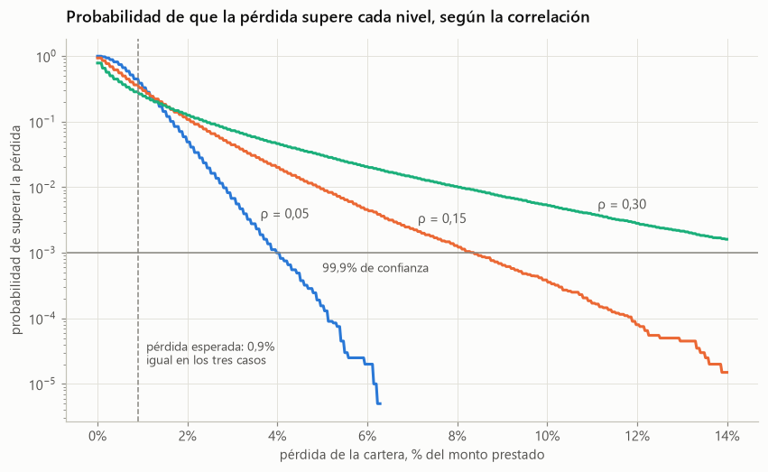
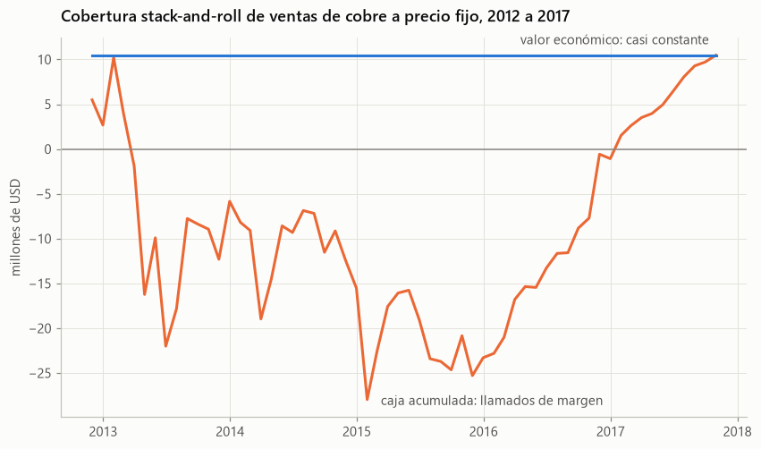
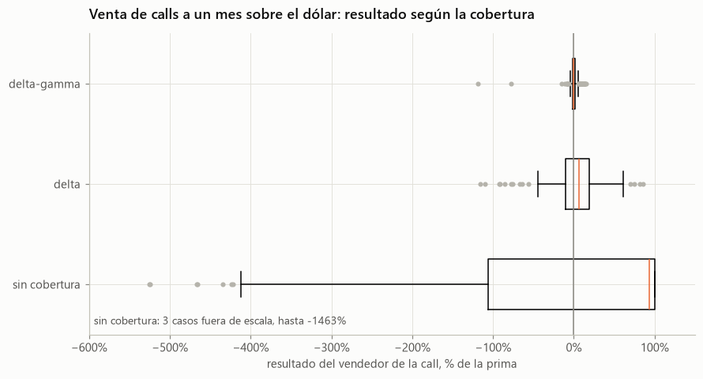

# FRM Parte I avanzado: los cuatro libros con datos chilenos y ejercicios resueltos en Python

Versión de mayor nivel de [05_FRM](../05_FRM/README.md). Recorre los 62 capítulos del programa 2026 del FRM Parte I de GARP, en el orden oficial, con análisis sobre datos reales de Chile y Estados Unidos, 131 ejercicios resueltos en Python y 124 preguntas de práctica con la respuesta oculta.

Integra el material de estudio de mi proyecto frm-prep: la estructura de capítulos con sus códigos de GARP, su banco de ejercicios resueltos, su banco de preguntas y sus motores de cálculo, llevados a Python con las mismas pruebas.

## Los cuatro notebooks

| Libro | Peso en el examen | Capítulos | Ejercicios resueltos | Preguntas | Notebook |
|---|---|---|---|---|---|
| 1. Fundamentos de la gestión de riesgos | 20% | 11 | 20 | 22 | [01_fundamentos_avanzado](01_fundamentos_avanzado.ipynb) |
| 2. Análisis cuantitativo | 20% | 15 | 33 | 30 | [02_cuantitativo_avanzado](02_cuantitativo_avanzado.ipynb) |
| 3. Mercados y productos financieros | 30% | 20 | 40 | 40 | [03_mercados_productos_avanzado](03_mercados_productos_avanzado.ipynb) |
| 4. Valoración y modelos de riesgo | 30% | 16 | 38 | 32 | [04_valoracion_riesgo_avanzado](04_valoracion_riesgo_avanzado.ipynb) |

Cada capítulo tiene cinco partes:

1. **Idea central:** los conceptos y fórmulas, escritos para quien ya conoce lo básico.
2. **Análisis avanzado:** una aplicación con datos reales o, cuando no hay datos públicos, una simulación con supuestos explícitos.
3. **Ejercicios resueltos en Python:** 31 vienen del banco de ejercicios de frm-prep, 5 de las pruebas de sus motores de cálculo y 95 son propios, de mayor dificultad.
4. **Preguntas de práctica:** 110 del banco de frm-prep y 14 propias para los capítulos que el banco no cubre. Las opciones se reordenan para que la respuesta correcta no quede siempre en la misma letra.
5. **Trampas frecuentes:** los errores que el examen suele explotar.

## Capítulos y análisis

### Libro 1. Fundamentos de la gestión de riesgos

| Código | Capítulo | Análisis avanzado |
|---|---|---|
| FRM-1 | Los fundamentos de la gestión de riesgos | La misma pérdida esperada con colas muy distintas |
| FRM-2 | Cómo gestionan las empresas el riesgo financiero | El valor de cubrirse cuando el impuesto es convexo |
| FRM-3 | La gobernanza de la gestión de riesgos | Del apetito de riesgo del directorio a los límites por mesa |
| FRM-4 | Mecanismos de transferencia del riesgo de crédito | Tramos de una CDO y el papel de la correlación |
| FRM-5 | Teoría moderna de carteras y CAPM | La cartera óptima con error de estimación |
| FRM-6 | APT y modelos multifactoriales | Riesgo sistemático e idiosincrático de las acciones del IPSA |
| FRM-7 | Agregación de datos de riesgo (BCBS 239) | Control de calidad sobre datos reales de la CMF |
| FRM-8 | Gestión integral de riesgos y tendencias | Agregación de capital económico y RAROC |
| FRM-9 | Lecciones de desastres financieros | Metallgesellschaft con el precio del cobre |
| FRM-10 | Anatomía de la gran crisis financiera | La crisis de 2007 a 2009 en datos de FRED |
| FRM-11 | Código de conducta de GARP | Dilemas resueltos |

### Libro 2. Análisis cuantitativo

| Código | Capítulo | Análisis avanzado |
|---|---|---|
| QA-1 | Fundamentos de probabilidad | Probabilidades condicionales entre el IPSA y el dólar |
| QA-2 | Variables aleatorias | Una mezcla de regímenes explica las colas del IPSA |
| QA-3 | Variables aleatorias univariadas comunes | Normal, t de Student y el conteo de excepciones del VaR |
| QA-4 | Variables aleatorias multivariadas | Dependencia en las colas y cópulas |
| QA-5 | Momentos muestrales | Cuán inciertas son la curtosis y el Sharpe estimados |
| QA-6 | Pruebas de hipótesis | Minería de datos con 200 estrategias al azar |
| QA-7 | Regresión lineal | Beta de un banco en tiempos normales y de crisis |
| QA-8 | Regresión con varias variables | Sesgo por variable omitida, verificado exactamente |
| QA-9 | Diagnóstico de la regresión | Heterocedasticidad, observaciones influyentes y colinealidad |
| QA-10 | Series de tiempo estacionarias | Estacionalidad de la inflación mensual |
| QA-11 | Series de tiempo no estacionarias | Cointegración de las tasas de los bonos del Banco Central |
| QA-12 | Retornos, volatilidad y correlación | Pearson, Spearman y Kendall entre el IPSA y el dólar |
| QA-13 | Simulación y bootstrapping | Variables de control y bootstrap por bloques |
| QA-14 | Métodos de aprendizaje automático | Grupos de bancos chilenos con k-medias y componentes principales |
| QA-15 | Aprendizaje automático y predicción | Modelos de incumplimiento, curvas ROC y umbral de costo mínimo |

### Libro 3. Mercados y productos financieros

| Código | Capítulo | Análisis avanzado |
|---|---|---|
| FMP-1 | Bancos | Capital de los bancos chilenos frente a Basilea III |
| FMP-2 | Seguros y fondos de pensiones | Prima de un seguro de vida y pasivos de pensiones ante las tasas |
| FMP-3 | Gestión de fondos | Comisiones con marca de agua y sesgo de supervivencia |
| FMP-4 | Introducción a los derivados | Perfiles de pago y apalancamiento sobre el dólar |
| FMP-5 | Bolsas y mercados OTC | Exposición de un forward con y sin colateral |
| FMP-6 | Compensación central | Márgenes procíclicos y la cascada de incumplimiento |
| FMP-7 | Mercados de futuros | Liquidez en riesgo por llamados de margen |
| FMP-8 | Cobertura con futuros | Cobertura cruzada de bancos con el ETF IPSA |
| FMP-9 | Mercados de divisas | ¿Pronostica el forward el tipo de cambio? |
| FMP-10 | Precio de forwards y futuros | Valor de mercado de un forward vivo |
| FMP-11 | Forwards y futuros de commodities | Reversión a la media del cobre y la curva forward |
| FMP-12 | Mercados de opciones | Warrants y bonos convertibles |
| FMP-13 | Propiedades de las opciones | Detector de arbitraje y frontera de ejercicio anticipado |
| FMP-14 | Estrategias con opciones | Nota con capital protegido y nivel de tasas |
| FMP-15 | Opciones exóticas | Exóticas sobre el dólar con fórmulas cerradas y Monte Carlo |
| FMP-16 | Propiedades de las tasas de interés | Curva cero de la tasa swap cámara por bootstrapping |
| FMP-17 | Bonos corporativos | El enigma del spread de crédito |
| FMP-18 | Hipotecas y MBS | Convexidad negativa y strips IO y PO |
| FMP-19 | Futuros de tasas de interés | El bono más barato de entregar |
| FMP-20 | Swaps | Valor de un swap vivo con la curva chilena |

### Libro 4. Valoración y modelos de riesgo

| Código | Capítulo | Análisis avanzado |
|---|---|---|
| VRM-1 | Medidas de riesgo financiero | VaR, ES y medidas espectrales del IPSA |
| VRM-2 | Cálculo y aplicación del VaR | VaR de componentes y VaR de una cartera con opciones |
| VRM-3 | Medición y monitoreo de la volatilidad | GARCH del dólar: estructura temporal y pronóstico fuera de muestra |
| VRM-4 | Calificaciones de crédito | PD a lo largo del ciclo frente a PD puntual con el IMACEC |
| VRM-5 | Riesgo país | Un tablero macroeconómico de riesgo para Chile |
| VRM-6 | Medición del riesgo de crédito | Capital IRB, granularidad y el modelo de Vasicek |
| VRM-7 | Riesgo operacional | Distribución de pérdidas, valores extremos y método estándar |
| VRM-8 | Pruebas de estrés | Prueba de estrés inversa con factores chilenos |
| VRM-9 | Convenciones de precio, descuento y arbitraje | Factores de descuento implícitos y un arbitraje de bonos |
| VRM-10 | Tasas de interés | Forwards, pendiente e inversión de la curva chilena |
| VRM-11 | Rendimientos de bonos y retornos | Carry, roll-down y cambio de tasas en el BCP a 10 años |
| VRM-12 | Duración, convexidad y DV01 | Barbell frente a bullet con la curva del Banco Central |
| VRM-13 | Cambios no paralelos de la curva | Componentes principales y coberturas de dos factores |
| VRM-14 | Árboles binomiales | El valor del ejercicio anticipado según plazo y moneyness |
| VRM-15 | El modelo Black-Scholes-Merton | ¿Acierta la lognormal con las probabilidades del dólar? |
| VRM-16 | Las griegas | Cobertura delta frente a delta-gamma con trayectorias reales |

## Algunos resultados

**La correlación decide el capital.** Una cartera de créditos con pérdida esperada de 0,9% necesita 3,1% de capital si la correlación con el ciclo es 0,05, y 14,9% si es 0,30.

**Una cobertura correcta puede quebrar por caja.** Con el precio real del cobre entre 2012 y 2017, una cobertura de ventas a precio fijo con futuros renovados mantiene su valor económico, pero exige financiar 28 millones de dólares en llamados de margen. Es el caso de Metallgesellschaft.

**La gamma explica el error de la cobertura delta.** Vendiendo calls a un mes sobre el dólar desde 2010, la cobertura delta diaria deja una desviación de 31% de la prima, y la delta-gamma, de 11%.

## Fórmulas validadas

Las fórmulas nuevas están en el módulo [frm_avanzado.py](../src/dsaplicado/frm_avanzado.py) y complementan a [frm.py](../src/dsaplicado/frm.py). Sus pruebas, en [test_frm_avanzado.py](../tests/test_frm_avanzado.py), se validan contra tres fuentes:

- **Los motores de cálculo de frm-prep.** El valor del dinero en el tiempo al estilo de la calculadora BA II Plus y los ratios de capital de Basilea III se portaron a Python con los mismos casos de prueba, como la cuota de 1.199,10 de un crédito de 200.000 a 30 años.
- **Las respuestas del banco de ejercicios de frm-prep,** como el precio del bono de 97,33, el forward de 1,3263 o el VaR diversificado de 6,08 millones.
- **Ejemplos publicados:** la asiática geométrica de 5,13 y el modelo de Merton de Hull, con activos de 12,40 y PD de 12,7%, y la ponderación IRB de 92,32% del Comité de Basilea para una PD de 1%.

## Advertencias

- **Apoyo, no reemplazo.** Los notebooks no reemplazan las lecturas oficiales de GARP.
- **Supuestos ilustrativos.** Algunos análisis usan parámetros supuestos, como las carteras de crédito, las pérdidas operacionales, los términos de los warrants o la velocidad de reversión del cobre, y así se indica en cada caso.
- **Aproximaciones de datos.** El ETF IPSA hace de futuro sobre el índice, el dólar observado de precio del futuro de dólar y la curva swap cámara de curva libre de riesgo en pesos.
- **Banco de preguntas.** Se excluyeron las preguntas del banco de frm-prep cuya clave no coincide con su explicación o cuya traducción no corresponde al enunciado original.
